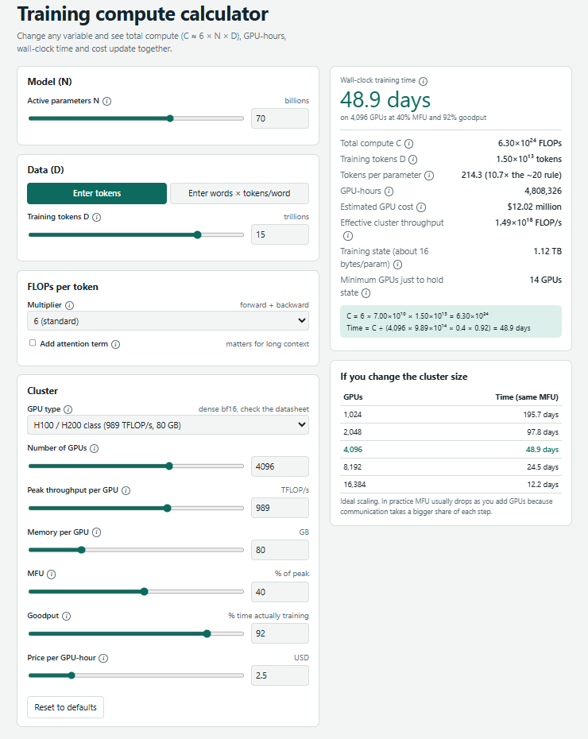

# LLM Training Compute Calculator

A single-file, no-install calculator that estimates how much compute, time and money it takes to train a transformer language model.

**Live demo:** `https://kiran-huex.github.io/llm-training-calculator/`



## What it does

Change any variable and the results update together:

- **Model:** active parameters `N`
- **Data:** training tokens `D`, entered directly or as words × fertility (tokens per word), with rough language presets
- **FLOPs per token:** multiplier of 6, 8 (activation recomputation) or custom, plus an optional attention term for long contexts
- **Cluster:** GPU count, peak throughput, memory, MFU, goodput, price per GPU-hour
- **Outputs:** total compute, wall-clock time, GPU-hours, estimated GPU cost, tokens per parameter, training-state memory and a minimum-GPU check

Every variable and abbreviation has an "i" tooltip.

It is one `index.html` with no dependencies, fonts or network requests. Open it in a browser, host it anywhere, or fork it.

## The formulas

```
C          = m × N × D                      (m = 6 by default)
per token  = m × N  +  m × L × ctx × d_model   (second term only if attention is enabled)
Effective  = GPUs × peak FLOP/s × MFU × goodput
Time       = C / Effective
GPU-hours  = Time × GPUs / 3600
Cost       = GPU-hours × price per GPU-hour
State mem  ≈ 16 bytes × N
D (words)  = words × fertility
```

Where the 6 comes from: the forward pass costs about 2 FLOPs per parameter per token (one multiply and one add), and the backward pass costs about twice the forward pass (4), so 2 + 4 = 6. Recomputing activations to save memory re-runs part of the forward pass and pushes the multiplier toward 8.

Variables:

| Symbol | Meaning |
|---|---|
| C | Total training compute in FLOPs (a count, not a rate) |
| N | Active parameters (for Mixture-of-Experts models, per-token active, not total) |
| D | Training tokens processed, including repeats |
| MFU | Model FLOPs Utilization: useful model FLOP/s divided by peak FLOP/s |
| Goodput | Share of wall-clock time making real training progress (failures, restarts, checkpoints lower it) |
| Fertility | Average tokens per word for a tokenizer and language |

## Validation against published runs

Run `node validate.js` to reproduce these numbers.

**Llama 3.1 405B** (N = 405B, D = 15.6T tokens, H100 at 989 TFLOP/s dense bf16):

| Check | Calculator | Published |
|---|---|---|
| Total compute | 3.79×10²⁵ FLOPs | about 3.8×10²⁵ FLOPs |
| GPU-hours at MFU 41%, goodput 100% | 26.0M | 30.84M (model card) |
| GPU-hours at MFU 41%, goodput 90% | 28.9M | 30.84M |
| GPU-hours at MFU 38%, goodput 90% | 31.1M | 30.84M |

The `6ND` compute estimate matches the reported figure to within 0.2%. GPU-hours depend heavily on the utilization you assume. The reported 30.84M GPU-hours implies about 34.5% overall utilization (MFU × goodput), which is below the 38 to 43% MFU Meta reported for individual training configurations, because the whole run also includes failures, restarts and different training stages.

**Llama 3 70B** (approximate N = 70B, D = 15T): the calculator gives 4.3M to 5.2M GPU-hours at the same assumptions, versus 6.4M reported, which implies about 28% overall utilization. Smaller models and smaller per-GPU workloads generally get lower utilization, so use a lower MFU for them.

**Takeaway:** the formula is reliable for total FLOPs. The wall-clock and cost outputs are only as good as your MFU and goodput inputs, which are the biggest source of error. Treat results as planning estimates, typically good to within tens of percent, and replace the defaults with measurements from a pilot run.

I could not directly verify every figure against the original papers while preparing this repo, so please check the sources below before relying on the numbers.

## Limitations

- **It is an estimate.** It is not a substitute for a pilot run on your actual cluster.
- **Pipeline bubbles, communication, stragglers and memory-bound operations** are not modeled individually. They are folded into the MFU you enter.
- **Storage, networking, staff, data preparation and failed experiments** are not in the cost.
- **Presets are rough.** GPU peaks are approximate dense bf16 figures (check the datasheet), and language fertility presets are illustrative. Measure fertility on your own text with your actual tokenizer.
- **Mixture-of-Experts:** enter active parameters as `N`. Expert routing communication overhead is not modeled.
- **Scaling is assumed ideal** in the cluster-size table. Real MFU typically drops as you add GPUs.
- **Memory check** assumes about 16 bytes per parameter (mixed-precision Adam) and ignores activations.

## Sources and credits

- Kaplan et al., *Scaling Laws for Neural Language Models* (2020): the `6ND` approximation.
- Hoffmann et al., *Training Compute-Optimal Large Language Models* (2022, "Chinchilla"): about 20 tokens per parameter as the compute-optimal rule of thumb.
- Chowdhery et al., *PaLM: Scaling Language Modeling with Pathways* (2023): the definition of MFU.
- Meta, *The Llama 3 Herd of Models* (arXiv 2407.21783) and the Llama 3 model cards: reference figures used in validation.

Related open-source tools: [dlcalc](https://github.com/jfc4050/dlcalc) (CLI performance modeling), [llm-flops](https://pypi.org/project/llm-flops/) (inference FLOPs), [llmcalc](https://github.com/simpx/llmcalc) (serving), and the LLM Compute-Optimal Estimator Space on Hugging Face.

## Contributing

Contributions are welcome. Especially useful:

- **GPU presets:** more accelerators (peak dense TFLOP/s per precision, memory), with a datasheet link
- **Tokenizer data:** measured fertility for real tokenizers and languages, with the corpus and method
- **MoE support:** active vs total parameters, expert parallelism overhead
- **More validation runs:** published runs with reported FLOPs, GPU-hours and hardware
- **Extras:** FP8 and other precisions, training-memory breakdown, energy estimates

Please open an issue to discuss larger changes. Keep it a single dependency-free `index.html` if you can.

## Publishing on GitHub Pages

1. Create a new public repo named `llm-training-calculator` and push these files.
2. In the repo, go to **Settings → Pages**.
3. Under **Build and deployment**, choose **Deploy from a branch**, select `main` and `/ (root)`, and save.
4. After a minute the site is live at `https://YOUR-USERNAME.github.io/llm-training-calculator/`.

## License

MIT. See [LICENSE](LICENSE).
